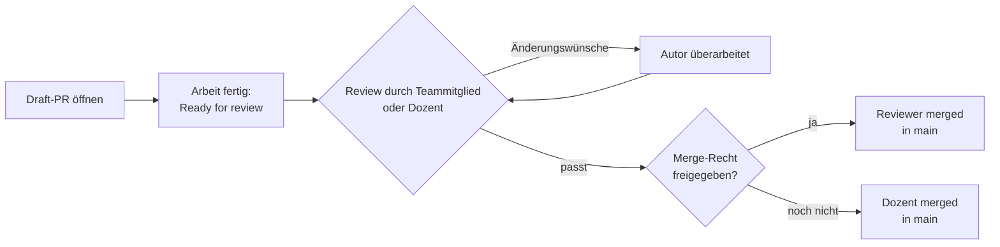
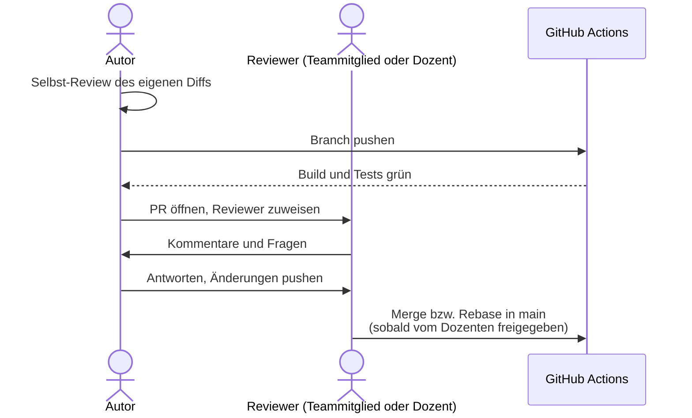
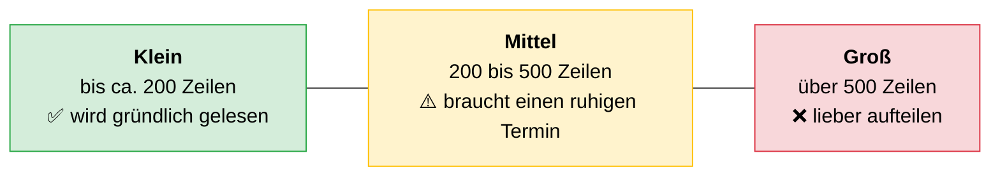
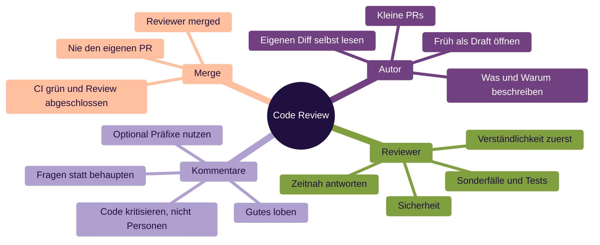

# Code Reviews

Bevor ein Pull Request in `main` landet, liest mindestens eine zweite Person den Code. Das ist ein **Code Review**. Es geht dabei nicht darum, Fehler zu finden, um jemanden bloßzustellen, sondern darum, dass der Code am Ende von **mehr als einer Person verstanden** wird und das Team gemeinsam besser wird.

:::tip[Du bist neu im Reviewen?]
Das ist normal. Niemand erwartet, dass du bei deinen ersten Reviews jeden Fehler findest. Ein Review, in dem du ehrlich schreibst „Diese Methode verstehe ich nicht, was macht sie?", ist bereits wertvoll. Wenn du es nicht verstehst, wird es in drei Monaten auch sonst niemand verstehen.
:::

## Warum überhaupt reviewen?

| Ziel | Was das konkret heißt |
|------|-----------------------|
| **Verständlichkeit** | Der Code kann von jemand anderem als dem Autor weiterentwickelt werden. |
| **Qualität** | Logikfehler, vergessene Sonderfälle und fehlende Tests fallen auf, bevor sie in `main` sind. |
| **Wissen teilen** | Wer reviewt, lernt Teile des Systems kennen, an denen er nicht selbst gearbeitet hat, z. B. Frontend-Leute das Backend und umgekehrt. |
| **Sicherheit** | Neue Abhängigkeiten, Umgang mit Benutzereingaben und Zugriffsrechte werden von einer zweiten Person angeschaut. |
| **Gute Teamkultur** | Feedback wird zur Gewohnheit, nicht zur Ausnahme. |

## Der Ablauf eines Reviews

Ein Pull Request durchläuft mehrere Stationen. Wichtig: Das Review ist **keine einmalige Abnahme** am Ende, sondern oft ein kurzes Hin und Her.

Dieselbe Sache aus Sicht der beteiligten Personen:

## Wer merged?

:::info[Regel]
**Wer reviewt, merged.** Niemand merged seinen eigenen Pull Request, auch nicht, wenn es „nur eine Kleinigkeit" ist.

Studierende dürfen erst mergen, **sobald der Dozent es im Projekt freigegeben hat**. Bis dahin merged der Dozent.
:::

Die Rollen im Überblick:

| Rolle | Aufgabe | Darf mergen? |
|-------|---------|:------------:|
| **Autor** | Bereitet den PR vor, beantwortet Kommentare, arbeitet Änderungen ein. Entscheidet, wann der PR „Ready for review" ist. | Nein |
| **Reviewer** | Liest den Code, stellt Fragen, entscheidet, wann der PR fertig ist. Wählt zwischen [Merge und Rebase](./branches-und-prs#merge-vs-rebase) und integriert den PR. | Ja, sobald vom Dozenten freigegeben |

Reviewer ist entweder ein anderes Teammitglied oder der Dozent. Wer reviewt, wird beim Öffnen des PRs auf GitHub eingetragen.

Warum so streng? Ein Merge ist der Moment, in dem Code für alle verbindlich wird und deployt wird (`main` ist immer deploybar, siehe [GitHub](../technik/github)). Das Vier-Augen-Prinzip funktioniert nur, wenn die Person, die den Code geschrieben hat, ihn nicht selbst freigibt.

**Voraussetzungen, bevor gemerged werden kann:**

- Build und Tests in GitHub Actions sind grün
- Der Reviewer, nicht der Autor, hat den Code gelesen und keine offenen Punkte mehr
- Alle Kommentare sind beantwortet oder bewusst als „später" markiert (dann mit eigenem Issue)
- Der Branch ist auf dem aktuellen Stand von `main` (siehe [Änderungen von Kollegen holen](./branches-und-prs#änderungen-von-kollegen-holen))

## Als Autor: den PR reviewbar machen

Ein gutes Review beginnt beim Autor. Je leichter der PR zu lesen ist, desto besser wird das Feedback.

### Kleine Pull Requests

Große PRs werden nicht gründlicher, sondern **oberflächlicher** reviewt. Bei 50 geänderten Zeilen liest man jede Zeile, bei 1.500 Zeilen scrollt man nur noch durch und merged.

Die Zahlen sind Faustregeln, keine harten Grenzen. Eine Story, die zu groß für einen PR ist, ist oft auch zu groß für einen Sprint, siehe [Story Points](./storypoints).

### Draft-PRs früh öffnen

Wer länger als einen Tag an einem Branch arbeitet, öffnet schon einen **Draft Pull Request** und trägt einen Reviewer ein. So sieht das Team, woran gearbeitet wird, und grundsätzliche Probleme fallen auf, bevor drei Tage Arbeit in die falsche Richtung geflossen sind.

### Checkliste vor „Ready for review"

- [ ] Ich habe meinen eigenen Diff auf GitHub einmal komplett durchgelesen (dabei fällt erstaunlich viel auf)
- [ ] Der Code kompiliert, Tests laufen lokal und in GitHub Actions grün
- [ ] Keine auskommentierten Code-Blöcke, keine Debug-Ausgaben (`System.out.println`, `console.log`)
- [ ] Warnungen der IDE (IntelliJ-Inspections, ESLint) sind behoben
- [ ] Die PR-Beschreibung erklärt **was** und **warum**, und verweist auf das Issue (`Closes #12`)
- [ ] Bei UI-Änderungen: ein Screenshot in der Beschreibung

## Als Reviewer: worauf achten?

Nicht alles ist gleich wichtig. Die folgenden Punkte sind nach Priorität sortiert: Ist der Code schon nicht verständlich, lohnt es sich noch nicht, über Stilfragen zu diskutieren.

### 1. Verständlichkeit

Verstehe ich den Code nur durch Lesen, ohne dass der Autor ihn mir erklären muss?

- Sagen Namen von Klassen, Methoden und Variablen, was sie tun? `calc(x)` oder `berechneNettopreis(bruttopreis)`?
- Ist eine Methode so lang, dass man scrollen muss? Dann tut sie vermutlich mehr als eine Sache.
- Würde ich diesen Code in drei Monaten noch verstehen?

### 2. Korrektheit und Sonderfälle

- Was passiert, wenn eine Liste leer ist, ein Wert `null` ist oder der Benutzer Unsinn eingibt?
- Werden Fehler sinnvoll behandelt, oder einfach geschluckt (`catch (Exception e) {}`)?

### 3. Tests

- Gibt es für neue Logik einen Test? Fällt dir ein Fall ein, der nicht getestet ist?
- Würde der Test fehlschlagen, wenn der Code kaputt wäre? Ein Test ohne sinnvolle Assertion prüft nichts.

### 4. Sicherheit

- Wird eine neue Bibliothek eingebunden? Ist sie wirklich nötig, und wird sie gepflegt?
- Stehen Passwörter, Tokens oder andere Geheimnisse im Code?
- Ist ein neuer Endpunkt abgesichert, oder kann ihn jeder aufrufen?

### 5. Stil

Nur ansprechen, wenn kein Tool es automatisch prüft. Einrückung, Leerzeichen und Import-Reihenfolge erledigen IDE und Formatter, darüber muss im Review niemand diskutieren.

### Tipps für das Vorgehen

- **Branch lokal auschecken**, wenn der PR größer ist. In der IDE kann man durch den Code navigieren, die Tests laufen lassen und sieht Warnungen, die auf GitHub nicht auffallen.
- **Erst die PR-Beschreibung und das Issue lesen.** Wer nicht weiß, was die Änderung erreichen soll, kann nicht beurteilen, ob sie es tut.
- **Notizen machen** während des Lesens, und erst am Ende entscheiden, welche Punkte wirklich wichtig sind.
- **Zeitnah reviewen.** Ein PR, der drei Tage auf ein Review wartet, blockiert das Team. Ziel: innerhalb eines Werktags eine erste Rückmeldung.

## Gute Kommentare schreiben

Der Ton entscheidet, ob ein Review hilft oder frustriert. Kritisiert wird **der Code, nie die Person**.

| ❌ So lieber nicht | ✅ Besser so |
|-------------------|-------------|
| „Das ist falsch." | „Ich glaube, hier fehlt der Fall, dass `kunde` null ist. Was passiert dann?" |
| „Warum hast du das so gemacht??" | „Kannst du kurz erklären, warum hier eine `Map` statt einer `List` verwendet wird? Ich verstehe den Vorteil noch nicht." |
| „Unleserlich." | „Die Methode macht drei Dinge. Würde es helfen, das Validieren in eine eigene Methode auszulagern?" |
| „Ich hätte das anders gemacht." | *(gar nicht schreiben, wenn es nur Geschmack ist)* |
| *(nur Kritik)* | „Schöne Lösung mit dem Enum, das ist viel lesbarer als vorher!" |

### Kommentare kennzeichnen (optional)

Wer möchte, kann einen Kommentar mit einem **Präfix** beginnen. Das ist freiwillig, hilft dem Autor aber zu erkennen, wie wichtig ein Kommentar ist:

| Präfix | Bedeutung | Muss vor dem Merge erledigt sein? |
|--------|-----------|:---------------------------------:|
| `issue:` | Ein echtes Problem, z. B. ein Fehler oder eine Sicherheitslücke | Ja |
| `question:` | Ich verstehe etwas nicht und möchte es erklärt bekommen | Antwort ja |
| `suggestion:` | Ein Verbesserungsvorschlag, der Autor entscheidet | Nein |
| `nit:` | Kleinigkeit (von *nitpick*), z. B. ein Tippfehler im Kommentar | Nein |
| `praise:` | Lob für etwas, das gut gelöst ist | Nein |

Beispiel auf GitHub:

> **suggestion:** Hier könnte man `Optional.ofNullable(...).orElse(...)` verwenden, dann spart man sich das `if`. Ist aber Geschmackssache, lass es gern so.

GitHub bietet außerdem **Suggested Changes**: Im Kommentarfeld auf das Symbol `±` klicken, die korrigierte Zeile eintragen, und der Autor kann den Vorschlag mit einem Klick übernehmen. Ideal für Tippfehler und Kleinigkeiten.

### Als Autor auf Kommentare reagieren

- Jeder Kommentar bekommt eine Antwort, auch wenn es nur „Erledigt" ist.
- Man muss nicht jedem Vorschlag folgen. Bei `suggestion:` und `nit:` darf man begründet ablehnen.
- Kommentare nicht persönlich nehmen. Ein Kommentar sagt „dieser Code kann besser werden", nicht „du bist schlecht".
- Wenn eine Diskussion mehr als zwei Runden hin und her geht: **kurz reden statt schreiben**, z. B. in der wöchentlichen Projektbetreuung.

## Was ein Review nicht ist

:::warning[Typische Fehler]
- **Keine Feature-Demo.** Ob die Funktion fachlich das Richtige tut, klärt das Sprint Review mit dem Product Owner, nicht das Code Review.
- **Kein Funktionstest.** Fallen beim Lesen Bugs auf, werden sie natürlich gemeldet. Der Reviewer muss aber nicht jeden Klickpfad ausprobieren, dafür gibt es Tests.
- **Keine Formatierungsdebatte.** Was ein Tool automatisch prüfen kann (Einrückung, Leerzeichen, Import-Reihenfolge), gehört nicht in ein Review.
- **Kein gemeinsames Programmieren.** Komplexe Probleme werden im Review benannt, nicht während des Reviews gelöst.
- **Kein Infragestellen des Features.** Ob ein Feature gebaut wird, entscheidet der Product Owner im Backlog. Im Review geht es um den Code.
- **Kein Häkchen auf dem Board.** Ein Merge nach zehn Sekunden Durchscrollen „weil es halt sein muss" hilft niemandem.
:::

## Kurzfassung

