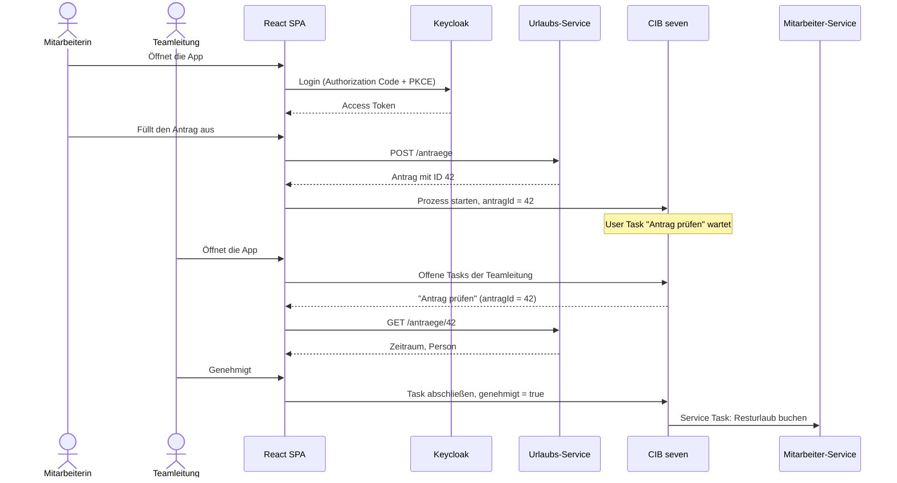

import ArchitekturDiagramm from '@site/src/components/ArchitekturDiagramm';

# Systemarchitektur

Das System besteht aus mehreren spezialisierten Komponenten, die als Container betrieben und über einen zentralen Reverse Proxy erreichbar gemacht werden.

## Übersicht

:::tip[Präsentation]
Die Architektur Schritt für Schritt aufgebaut, am Beispiel eines Urlaubsantrags: [Präsentation zur Systemarchitektur öffnen](pathname:///slides/architektur.html). Steuerung mit den Pfeiltasten, `f` für Vollbild.
:::

<ArchitekturDiagramm />

Das Diagramm zeigt zwei Microservices stellvertretend für beliebig viele. Selbst entwickelt werden die React SPA, die Microservices und die BPMN-Prozesse. Nginx Proxy Manager, Keycloak, die Datenbanken und die Engine von CIB seven werden nur betrieben.

Alle Aufrufe aus dem Browser laufen über den Nginx Proxy Manager, auch die an Microservices, CIB seven und Keycloak. Das Diagramm zeigt deshalb nur eine Kante vom Proxy zur SPA. Wer mit dem Mauszeiger auf einen Baustein zeigt, sieht eine kurze Erklärung.

## Warum diese Bausteine?

Jeder Baustein beantwortet eine konkrete Anforderung. Am Beispiel eines Urlaubsantrags: Eine Mitarbeiterin beantragt Urlaub, die Teamleitung genehmigt, danach sinkt der Resturlaub.

| Anforderung | Baustein |
|---|---|
| Mitarbeitende bedienen das System im Browser | React SPA |
| Anträge und Resturlaub werden dauerhaft gespeichert | Microservices mit je eigener PostgreSQL-Datenbank |
| Der Antrag durchläuft einen festen Ablauf mit Genehmigung | CIB seven führt den Ablauf als BPMN-Prozess aus |
| Nur die Teamleitung darf genehmigen | Keycloak stellt Tokens mit Rollen aus |
| Alles ist sicher unter einer Adresse erreichbar | Nginx Proxy Manager mit TLS und Subdomains |
| Neue Versionen kommen kontrolliert auf den Server | GitHub Actions baut Images, Portainer rollt sie aus |

Zwei Grundsätze halten die Bausteine auseinander:

- **Jeder Microservice besitzt seine Daten.** Ein Urlaubs-Service liest nie direkt die Tabellen eines Mitarbeiter-Service, sondern fragt dessen REST-API. So kann jeder Service sein Schema ändern, ohne andere zu brechen, und wird eigenständig versioniert.
- **Der Ablauf gehört in die Process Engine, die Fachdaten in die Services.** CIB seven weiß, wo ein Antrag im Prozess steht und bei wem er liegt. Was ein Antrag ist (Zeitraum, Person), weiß nur der zuständige Service. Im Prozess stehen deshalb meist nur IDs, siehe [Daten in BPMN Prozessen](../methodik/bpmn-daten).

## Komponenten

### [Nginx Proxy Manager](https://nginxproxymanager.com/) Reverse Proxy

Nginx Proxy Manager ist der einzige öffentlich erreichbare Endpunkt. Er nimmt alle eingehenden HTTPS-Anfragen entgegen und leitet sie anhand von Subdomain-Regeln an den zuständigen Container weiter. Dadurch sind die internen Dienste nicht direkt exponiert. Die Konfiguration der Proxy-Hosts, SSL-Zertifikate (Let's Encrypt) und Weiterleitungen erfolgt über eine Weboberfläche, ohne manuelle nginx-Konfigurationsdateien.

Mehr zur Konfiguration, zum Docker-Netzwerk und zum Anlegen von Proxy-Hosts auf der [Nginx Proxy Manager-Seite](./reverse-proxy).

### [React](https://react.dev/) Frontend

Die Benutzeroberfläche ist eine Single Page Application auf Basis von React. Sie spricht zwei Backends über REST an: Fachdaten, etwa eine Liste von Entitäten, holt sie von den Microservices. Sobald sie mit einem Prozess interagiert, etwa um die offenen Tasks des eingeloggten Nutzers anzuzeigen oder einen Prozess zu starten, geht sie direkt an die REST API von CIB seven. Die Authentifizierung läuft über Keycloak: Nach dem Login speichert die App das JWT und schickt es bei jedem API-Aufruf als Bearer-Token mit. Details zur Authentifizierung beschreibt die [OAuth2/OIDC-Seite](./oauth2-oidc).

### [Keycloak](https://www.keycloak.org/) OIDC Provider

Keycloak übernimmt die zentrale Authentifizierung und Autorisierung nach dem OpenID-Connect-Standard. Nach erfolgreichem Login erhält der Client ein JWT, das bei jedem API-Aufruf mitgeschickt wird. Alle Microservices und CIB seven validieren dieses Token direkt gegen Keycloak. Mehr dazu auf der [OAuth2/OIDC-Seite](./oauth2-oidc).

### [CIB seven](https://cibseven.org/en/) Process Engine

CIB seven ist ein Fork von Camunda 7 und stellt die BPMN-Prozess-Engine bereit. Geschäftsprozesse werden als BPMN-Diagramme modelliert und von CIB seven ausgeführt. Die Microservices können Prozessinstanzen starten, Tasks abarbeiten und Prozessvariablen lesen und schreiben. Das Frontend nutzt dieselbe REST API für alles, was den Prozess betrifft, zum Beispiel die Liste der offenen Tasks. Mehr dazu auf der [CIB seven-Seite](./cibseven).

### Microservices ([Quarkus](https://quarkus.io/))

Die fachliche Logik ist auf spezialisierte Microservices aufgeteilt, die jeweils mit Quarkus implementiert sind. Quarkus bietet kurze Startup-Zeiten und geringen Speicherbedarf, was den Container-Betrieb vereinfacht. Die Microservices kommunizieren mit der Process Engine über deren REST-API und sichern ihre eigenen Endpunkte mit den von Keycloak ausgestellten Tokens ab. Mehr dazu auf der [Microservices-Seite](./microservices).

## Ein Durchlauf am Beispiel

So spielen die Bausteine bei einem Urlaubsantrag zusammen. Alle Aufrufe aus dem Browser laufen über den Nginx Proxy Manager; er ist im Diagramm weggelassen, weil er nur weiterleitet. Jeder Service und CIB seven prüfen das mitgeschickte JWT selbst, wie auf der [OAuth2/OIDC-Seite](./oauth2-oidc#api-aufruf-mit-token-validierung) beschrieben.

Das Muster dahinter ist die [Faustregel aus dem Frontend](./frontend): Fachdaten wie den Antrag selbst holt die SPA vom Microservice, alles, was den Prozess betrifft (starten, offene Tasks, abschließen), geht direkt an CIB seven. Den Service Task führt die Engine selbst aus und orchestriert damit die Microservices.
